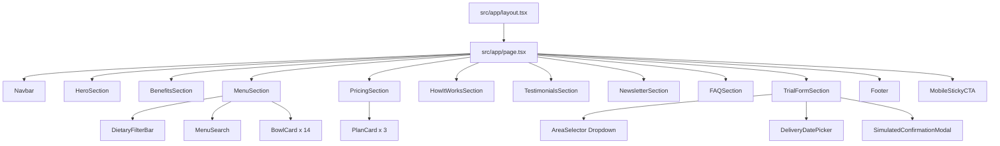
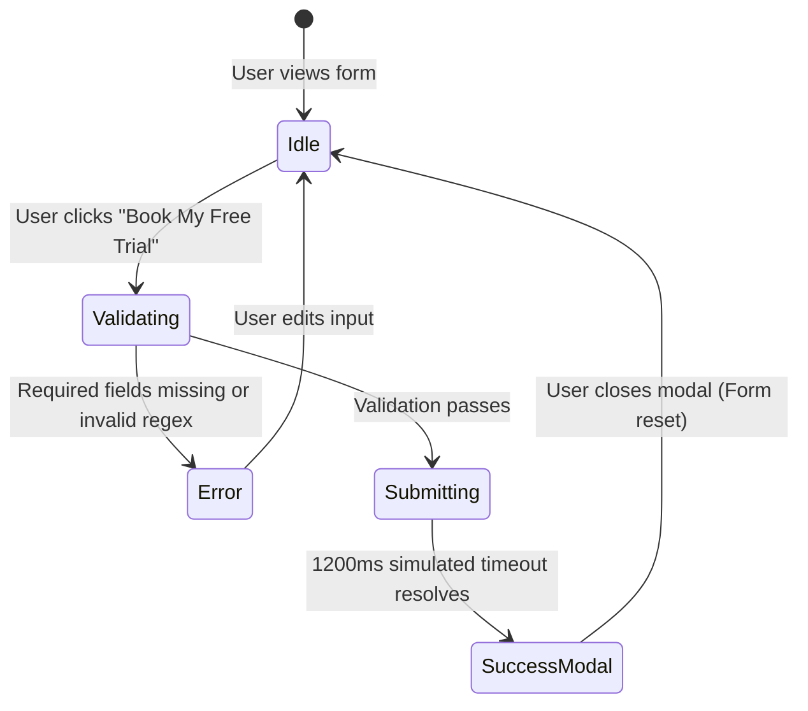
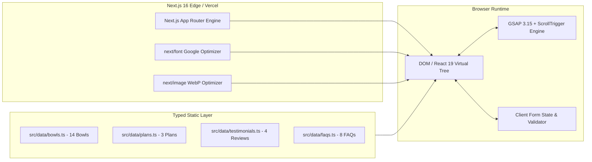

# FitBowl — Technical Architecture Document

**Document Version:** 1.0.0  
**Document Status:** Approved for Implementation  
**Last Updated:** 2026-10-18  
**Author:** Senior Software Architect & Technical Lead  
**Cross-References:** [brd.md](file:///e:/company/practice/fitbowl/docs/brd.md), [frd.md](file:///e:/company/practice/fitbowl/docs/frd.md), [rule.md](file:///e:/company/practice/fitbowl/docs/rule.md), [ui-ux-specification.md](file:///e:/company/practice/fitbowl/docs/ui-ux-specification.md), [phases.md](file:///e:/company/practice/fitbowl/docs/phases.md)

---

## Table of Contents
1. [System Overview & Architectural Philosophy](#1-system-overview--architectural-philosophy)
2. [Technology Stack & Rationale](#2-technology-stack--rationale)
3. [Application Directory & File Structure](#3-application-directory--file-structure)
4. [Component Architecture & Hierarchy](#4-component-architecture--hierarchy)
5. [Data Architecture & TypeScript Schemas](#5-data-architecture--typescript-schemas)
6. [Routing, Layout & Page Structure](#6-routing-layout--page-structure)
7. [Design Tokens & Styling Strategy (Tailwind CSS v4)](#7-design-tokens--styling-strategy-tailwind-css-v4)
8. [Animation Architecture & GSAP Lifecycle Management](#8-animation-architecture--gsap-lifecycle-management)
9. [Form State Management & Simulated Engine](#9-form-state-management--simulated-engine)
10. [Asset Optimization & Font Loading Strategy](#10-asset-optimization--font-loading-strategy)
11. [Error Handling & Edge Boundary Strategy](#11-error-handling--edge-boundary-strategy)
12. [Performance & Core Web Vitals Optimization](#12-performance--core-web-vitals-optimization)
13. [Accessibility (a11y) Architecture](#13-accessibility-a11y-architecture)
14. [SEO & Metadata Architecture](#14-seo--metadata-architecture)
15. [Testing & Quality Assurance Strategy](#15-testing--quality-assurance-strategy)
16. [Deployment & CI/CD Pipeline](#16-deployment--cicd-pipeline)
17. [Security Considerations](#17-security-considerations)
18. [System Architecture Diagram](#18-system-architecture-diagram)
19. [Future Scalability & Backend Evolution Roadmap](#19-future-scalability--backend-evolution-roadmap)

---

## 1. System Overview & Architectural Philosophy

FitBowl is architected as an ultra-high performance, accessible, single-page web application leveraging the **Next.js 16 App Router** alongside **React 19**, **Tailwind CSS v4**, and **GSAP 3.15**. 

### Core Architectural Principles
1. **Zero Unnecessary Bloat:** The repository purposefully relies on native React 19 primitives, TypeScript interfaces, and standard browser APIs rather than piling on heavy third-party dependencies (e.g., no bulky form libraries or external state containers like Redux).
2. **Separation of Concerns:** Business data (menus, plans, testimonials, FAQs) is strictly segregated into typed static data modules, ensuring presentation components remain purely declarative.
3. **Safe Animation Lifecycles:** GSAP and ScrollTrigger animations are strictly encapsulated in React contexts with deterministic teardown mechanisms to prevent memory leaks, layout thrashing, or stale triggers.
4. **Resilient Client Architecture:** The frontend emulates real-world operational flows (including network latency and form validations) without requiring an active backend or exposing unconfigured API endpoints.

---

## 2. Technology Stack & Rationale

| Layer | Selected Technology | Version | Architectural Rationale |
|---|---|---|---|
| **Framework** | Next.js (App Router) | `16.4.2` | High-speed static generation (SSG), automatic route prefetching, integrated metadata API, server components where applicable. Subject to Next.js 16 breaking conventions (see [nextjs-agent-rules.md](file:///e:/company/practice/fitbowl/docs/nextjs-agent-rules.md)). |
| **View Library** | React & React DOM | `19.3.0` | Latest concurrent rendering features, native form hooks (`useActionState`, `useTransition`), enhanced hydration performance. |
| **Styling Engine** | Tailwind CSS | `v4.x` (`@tailwindcss/turbopack`) | Modern CSS-first token configuration with `@theme inline`, zero runtime CSS overhead, rapid responsive styling. |
| **Animation Engine**| GreenSock (GSAP) | `^3.15.0` | Industry gold standard for silky smooth timelines, SVG manipulation, and ScrollTrigger spatial reveals. |
| **Iconography** | Lucide React | `^1.59.0` | Feather-light tree-shakeable SVG icon set with customizable stroke and dimensions. |
| **Language** | TypeScript | `^5.x` | End-to-end type safety, compile-time schema validation for bowls, plans, and customer data. |
| **Quality & Linter**| ESLint with `eslint-config-next` | `^9.x` / `16.4.2` | Code consistency, import hygiene, and React 19 hooks linting rules. |

---

## 3. Application Directory & File Structure

The workspace follows a clean, feature-driven modular structure within the `src/` directory:

```text
fitbowl/
├── docs/                                  # Complete product & architectural documentation
│   ├── ui-ux-specification.md
│   ├── wireframe.md
│   ├── brd.md
│   ├── frd.md
│   ├── architecture.md
│   ├── rule.md
│   ├── seo.md
│   └── phases.md
├── public/                                # Static assets, favicons, food imagery, logos
│   ├── images/
│   │   ├── logo/
│   │   │   ├── fitbowl-logo.svg           # Official brand logo vector
│   │   │   └── fitbowl-mark.svg           # Isolated bowl emblem
│   │   ├── hero/
│   │   │   └── hero-bowl.webp             # High-res preloaded hero bowl
│   │   ├── bowls/                         # 14 signature dish photographs
│   │   │   ├── peri-peri-paneer.webp
│   │   │   ├── butter-chicken-lite.webp
│   │   │   └── ... (14 items)
│   │   └── testimonials/                  # Customer profile avatars
│   │       ├── riya-s.webp
│   │       ├── karan-m.webp
│   │       ├── sneha-p.webp
│   │       └── arjun-k.webp
│   ├── favicon.ico
│   └── robots.txt
├── src/
│   ├── app/                               # Next.js App Router layer
│   │   ├── layout.tsx                     # Root layout with font declarations & SEO metadata
│   │   ├── page.tsx                       # Main landing page assembling sections
│   │   ├── globals.css                    # Tailwind v4 import & @theme design tokens
│   │   ├── sitemap.ts                     # Dynamic XML sitemap generator
│   │   └── robots.ts                      # Robots.txt crawler configuration
│   ├── components/                        # UI and Section Components
│   │   ├── layout/
│   │   │   ├── Navbar.tsx                 # Sticky navigation with mobile drawer
│   │   │   └── Footer.tsx                 # 4-column brand footer
│   │   ├── sections/
│   │   │   ├── HeroSection.tsx            # Hero with dual CTAs and trust strip
│   │   │   ├── BenefitsSection.tsx        # 4 Why FitBowl cards
│   │   │   ├── MenuSection.tsx            # 14 bowls, dietary filters & live search
│   │   │   ├── PricingSection.tsx         # 3 subscription plans (highlighting Regular)
│   │   │   ├── HowItWorksSection.tsx      # 4 sequential process steps
│   │   │   ├── TestimonialsSection.tsx    # 4 verified customer reviews
│   │   │   ├── NewsletterSection.tsx      # Retention / waitlist input
│   │   │   ├── FAQSection.tsx             # 8 accessible accordion items
│   │   │   └── TrialFormSection.tsx       # Booking form with area routing & date logic
│   │   └── ui/                            # Shared reusable UI primitives
│   │       ├── Button.tsx                 # Primary, secondary, outline button variants
│   │       ├── BowlCard.tsx               # Individual menu dish card
│   │       ├── PlanCard.tsx               # Subscription pricing card
│   │       ├── Accordion.tsx              # Generic accessible accordion container
│   │       ├── MobileStickyCTA.tsx        # Floating bottom conversion trigger
│   │       └── Modal.tsx                  # Accessible dialog overlay
│   ├── data/                              # Strongly typed static domain models
│   │   ├── bowls.ts                       # All 14 signature bowls with calories/protein
│   │   ├── plans.ts                       # Starter, Regular, Pro subscription details
│   │   ├── testimonials.ts                # 4 exact customer reviews
│   │   └── faqs.ts                        # 8 verified FAQ questions and answers
│   ├── hooks/                             # Custom React hooks
│   │   ├── useScrollPosition.ts           # Scroll offset detection for sticky states
│   │   └── useReducedMotion.ts            # Accessibility motion preference listener
│   ├── types/                             # TypeScript interfaces & types
│   │   ├── menu.ts                        # BowlItem, DietaryFilter, NutritionInfo
│   │   ├── pricing.ts                     # SubscriptionPlan, PlanFeature
│   │   ├── trial.ts                       # TrialFormData, FormValidationErrors
│   │   └── feedback.ts                    # Testimonial, FAQItem
│   └── utils/                             # Pure utility helpers
│       ├── validation.ts                  # Mobile, name, and date validator functions
│       └── formatters.ts                  # Currency (₹) and date formatters
├── next.config.ts                         # Next.js compiler & image domain config
├── tsconfig.json                          # Strict TypeScript configuration
└── package.json                           # Dependencies and build scripts
```

---

## 4. Component Architecture & Hierarchy

Components follow a structured hierarchical flow: **Layout -> Page -> Section Containers -> Feature Components -> UI Primitives**.



### Component Guidelines
- **Stateless Primitives:** Components like `Button`, `BowlCard`, and `PlanCard` receive data via strict props; they contain no side-effects or network calls.
- **Client vs. Server Components:** In Next.js 16, interactive elements that handle GSAP animations, form input state, or browser scroll listeners are explicitly tagged with `'use client';` at the top of the module.
- **Single Source of Truth:** Form values and menu filter states are maintained at the appropriate section level and passed downward.

---

## 5. Data Architecture & TypeScript Schemas

All domain data is defined as strongly typed static structures in `src/data/`.

### 5.1 Menu Bowl Schema (`src/types/menu.ts`)
```typescript
export type DietaryType = 'veg' | 'non-veg';

export interface NutritionInfo {
  calories: number; // in kcal
  protein: number;  // in grams
}

export interface BowlItem {
  id: string;
  name: string;
  type: DietaryType;
  nutrition: NutritionInfo;
  ingredients: string;
  image: string;
  isFridayOnly?: boolean;
}
```

### 5.2 Subscription Plan Schema (`src/types/pricing.ts`)
```typescript
export interface SubscriptionPlan {
  id: 'starter' | 'regular' | 'pro';
  name: string;
  mealsPerMonth: number;
  totalPrice: number;       // in INR
  pricePerMeal: number;     // in INR
  isPopular?: boolean;
  features: string[];
}
```

### 5.3 Trial Booking Form Schema (`src/types/trial.ts`)
```typescript
export type DeliveryHub = 'andheri' | 'bandra' | 'powai' | 'lower-parel' | 'other';

export interface TrialFormData {
  fullName: string;
  mobile: string;
  deliveryArea: DeliveryHub;
  foodPreference: DietaryType;
  deliveryDate: string; // ISO date string (YYYY-MM-DD)
  customAreaNotes?: string; // used when deliveryArea === 'other'
}

export interface FormValidationErrors {
  fullName?: string;
  mobile?: string;
  deliveryArea?: string;
  foodPreference?: string;
  deliveryDate?: string;
}
```

---

## 6. Routing, Layout & Page Structure

### 6.1 Single-Page Architecture
FitBowl is organized as a unified high-conversion landing page under `src/app/page.tsx`. This avoids jarring page reloads, preserves animation contexts, and facilitates seamless anchor scrolling across sections.

### 6.2 Anchor Targets
- `#menu` -> `MenuSection`
- `#plans` -> `PricingSection`
- `#how-it-works` -> `HowItWorksSection`
- `#reviews` -> `TestimonialsSection`
- `#faqs` -> `FAQSection`
- `#trial-form` -> `TrialFormSection`

---

## 7. Design Tokens & Styling Strategy (Tailwind CSS v4)

Tailwind CSS v4 utilizes the modern CSS `@theme` directive inside `src/app/globals.css`, eliminating legacy `tailwind.config.js` overhead while providing instantaneous compilation through Turbopack.

### 7.1 Design Tokens in `src/app/globals.css`
```css
@import "tailwindcss";

:root {
  --background: #FFF7E8;
  --foreground: #173F32;
  --color-forest-green: #173F32;
  --color-orange: #F47738;
  --color-warm-cream: #FFF7E8;
  --color-soft-leaf: #DCEBCF;
  --color-forest-dark: #0F2C23;
  --color-border-subtle: #E3D8C4;
}

@theme inline {
  --color-background: var(--background);
  --color-foreground: var(--foreground);
  --color-forest: #173F32;
  --color-forest-dark: #0F2C23;
  --color-orange: #F47738;
  --color-cream: #FFF7E8;
  --color-leaf: #DCEBCF;
  
  --font-heading: var(--font-bricolage), sans-serif;
  --font-body: var(--font-nunito), sans-serif;
  
  --breakpoint-xs: 390px;
}

body {
  background-color: var(--color-warm-cream);
  color: var(--color-forest-green);
  font-family: var(--font-body);
}
```

---

## 8. Animation Architecture & GSAP Lifecycle Management

### 8.1 Safety Rules for GSAP in React
1. **Always Use `gsap.context()`:** All GSAP timelines, tweens, and ScrollTrigger instances must be declared inside a `gsap.context()` call.
2. **Deterministic Cleanup:** The cleanup function returned by `gsap.context()` (`ctx.revert()`) must be invoked on component unmount to clean up DOM references and destroy ScrollTrigger instances.
3. **Reduced Motion Respect:** Check `window.matchMedia('(prefers-reduced-motion: reduce)')` prior to initializing animated timelines.

### 8.2 Standard GSAP Hook Pattern
```typescript
'use client';

import { useLayoutEffect, useRef } from 'react';
import gsap from 'gsap';
import { ScrollTrigger } from 'gsap/ScrollTrigger';

if (typeof window !== 'undefined') {
  gsap.registerPlugin(ScrollTrigger);
}

export function useGsapReveal() {
  const containerRef = useRef<HTMLDivElement>(null);

  useLayoutEffect(() => {
    const isReducedMotion = window.matchMedia('(prefers-reduced-motion: reduce)').matches;
    if (isReducedMotion || !containerRef.current) return;

    const ctx = gsap.context(() => {
      gsap.from('[data-reveal]', {
        y: 30,
        opacity: 0,
        duration: 0.6,
        stagger: 0.1,
        ease: 'power2.out',
        scrollTrigger: {
          trigger: containerRef.current,
          start: 'top 85%',
          toggleActions: 'play none none none',
        },
      });
    }, containerRef);

    return () => ctx.revert(); // Complete lifecycle cleanup
  }, []);

  return containerRef;
}
```

---

## 9. Form State Management & Simulated Engine

The Free Trial Form utilizes lightweight React state without bulky third-party form wrappers.

### 9.1 Form State Transition Machine


### 9.2 Validation Rules Engine (`src/utils/validation.ts`)
- **Name:** Trimmed length `>= 2` characters; alphabetic and spaces only.
- **Mobile Number:** 10 digits; must match `/^[6-9]\d{9}$/`.
- **Delivery Area:** Must be selected from pre-approved enum.
- **Date:** Valid date string; must not fall on Sunday (`getDay() !== 0`); must be within 14 days of current date.

---

## 10. Asset Optimization & Font Loading Strategy

### 10.1 Font Optimization via `next/font/google`
Fonts are configured in `src/app/layout.tsx` using `next/font/google`. They are automatically downloaded at build time, self-hosted on the deployment origin, and served with zero Google tracking and zero layout shift (CLS = 0).

```typescript
import { Bricolage_Grotesque, Nunito } from 'next/font/google';

export const bricolage = Bricolage_Grotesque({
  subsets: ['latin'],
  variable: '--font-bricolage',
  display: 'swap',
  weight: ['600', '700', '800'],
});

export const nunito = Nunito({
  subsets: ['latin'],
  variable: '--font-nunito',
  display: 'swap',
  weight: ['400', '500', '600', '700'],
});
```

### 10.2 Image Optimization
- Hero Bowl image configured with `priority={true}` and explicit `width={640}` and `height={640}` to guarantee rapid LCP rendering.
- Menu bowl thumbnails use Next.js `<Image />` with `loading="lazy"` and modern WebP compression.

---

## 11. Error Handling & Edge Boundary Strategy

1. **React Error Boundaries:** A global `error.tsx` boundary catches runtime rendering exceptions, rendering a friendly "Kitchen is momentarily busy" card with a reload action.
2. **Missing Asset Fallbacks:** Image components provide an `onError` fallback replacing failed dish photos with a styled SVG bowl illustration.
3. **Empty Filter Handling:** Menu filters display an instructive empty state if a search query yields no matches.

---

## 12. Performance & Core Web Vitals Optimization

| Metric | Target | Optimization Strategy |
|---|---|---|
| **LCP (Largest Contentful Paint)** | `< 2.2s` | Preloaded hero image, inline critical CSS, self-hosted next/font |
| **CLS (Cumulative Layout Shift)** | `< 0.05` | Explicit aspect ratios on all image containers; font `display: 'swap'` with font metric overrides |
| **INP (Interaction to Next Paint)**| `< 100ms` | Debounced menu search (150ms); lightweight GSAP timelines without main thread blocking |
| **Total Bundle Size (JS)** | `< 95 kB` gzipped | Tree-shaken Lucide icons; zero redundant dependencies |

---

## 13. Accessibility (a11y) Architecture

- **Semantic Landmarks:** `<header>`, `<main>`, `<section>`, `<nav>`, `<footer>`.
- **Contrast Ratios:** Forest Green `#173F32` on Warm Cream `#FFF7E8` achieves a contrast of `9.8:1` (WCAG AAA).
- **Keyboard Trapping:** Modal dialogs intercept focus, prevent background scroll, and release focus back to the triggering CTA on dismissal.
- **Screen Reader Announcements:** Form validation errors are bound to inputs using `aria-describedby` and `aria-invalid="true"`.

---

## 14. SEO & Metadata Architecture

Next.js App Router provides static metadata generation via `export const metadata: Metadata` in `src/app/layout.tsx`.
- **Title:** `FitBowl — Healthy Meal Subscription in Mumbai | Fresh Veg & Non-Veg Bowls`
- **Meta Description:** `Chef-crafted, macro-balanced healthy meal subscription delivered across Mumbai (Andheri, Bandra, Powai, Lower Parel). 14 signature bowls. Claim your free trial today!`
- **Structured Data:** Embeds JSON-LD schemas for `Organization`, `LocalBusiness`, and `FAQPage`.

---

## 15. Testing & Quality Assurance Strategy

1. **Static Analysis & Linting:** Run `npm run lint` with ESLint 9 to detect invalid imports, unhandled variables, or improper hook usages.
2. **TypeScript Compilation:** Run `npx tsc --noEmit` to verify type completeness across all 14 bowl definitions and form states.
3. **Cross-Browser Verification:** Verify desktop Chrome, Safari, Edge, and mobile Safari/Chrome at `1440px`, `768px`, and `390px`.
4. **Form Edge Testing:** Test invalid phone numbers, empty fields, Sunday dates, and out-of-area selections.

---

## 16. Deployment & CI/CD Pipeline

- **Target Host:** Vercel (Edge Network) or Netlify.
- **Build Command:** `npm run build` (`next build`).
- **Environment Variables:** None required for frontend-only execution (optional `NEXT_PUBLIC_SITE_URL`).
- **Deploy Trigger:** Pushes to the `main` GitHub branch trigger automatic zero-downtime previews and production deployments.

---

## 17. Security Considerations

- **Input Sanitization:** React automatically escapes string interpolations, preventing XSS vulnerabilities.
- **Client Rate Limiting:** Form submit buttons disable immediately on click, preventing double-submission or simulated spamming.
- **Zero Exposed Secrets:** As a static frontend application, no database credentials or private API keys exist in the client bundle.

---

## 18. System Architecture Diagram



---

## 19. Future Scalability & Backend Evolution Roadmap

When FitBowl transitions from this marketing & trial landing phase to a full-scale commercial subscription platform, the architecture is designed to scale cleanly:

1. **Backend Integration (Phase 2):** Introduce Next.js Server Actions or dedicated FastAPI/Node microservices to persist trial bookings into a PostgreSQL / Supabase database.
2. **SMS Gateway:** Integrate Sinch or Twilio to dispatch OTPs and real-time trial delivery tracking links to Mumbai phone numbers.
3. **Payment & Subscription Engine:** Integrate Razorpay Subscriptions or Cashfree for recurring monthly plan auto-debits (Starter, Regular, Pro).
4. **Kitchen Dispatch System:** Build a dedicated kitchen dashboard for daily prep counts (e.g., Friday Mutton Keema volume) and delivery route optimization across Andheri, Bandra, Powai, and Lower Parel.
