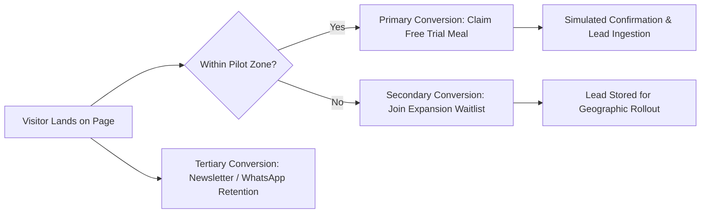

# FitBowl — Business Requirements Document (BRD)

**Document Version:** 1.0.0  
**Document Status:** Approved for Implementation  
**Last Updated:** 2026-10-18  
**Author:** Senior Product Manager & Strategic Technical Architect  
**Cross-References:** [frd.md](file:///e:/company/practice/fitbowl/docs/frd.md), [ui-ux-specification.md](file:///e:/company/practice/fitbowl/docs/ui-ux-specification.md), [wireframe.md](file:///e:/company/practice/fitbowl/docs/wireframe.md), [architecture.md](file:///e:/company/practice/fitbowl/docs/architecture.md), [phases.md](file:///e:/company/practice/fitbowl/docs/phases.md)

---

## Table of Contents
1. [Executive Summary](#1-executive-summary)
2. [Business Background & Problem Statement](#2-business-background--problem-statement)
3. [Business Objectives & Key Results (OKRs)](#3-business-objectives--key-results-okrs)
4. [Target Audience & User Personas](#4-target-audience--user-personas)
5. [Conversion Architecture (Primary & Secondary Goals)](#5-conversion-architecture-primary--secondary-goals)
6. [Scope & Out-of-Scope Boundaries](#6-scope--out-of-scope-boundaries)
7. [Stakeholder Matrix](#7-stakeholder-matrix)
8. [Business Requirements Matrix (BR-001 to BR-016)](#8-business-requirements-matrix-br-001-to-br-016)
9. [Operational Business Rules & Policies](#9-operational-business-rules--policies)
10. [Success Metrics & KPI Targets](#10-success-metrics--kpi-targets)
11. [Risks, Assumptions & Dependencies](#11-risks-assumptions--dependencies)
12. [Delivery & Operational Constraints](#12-delivery--operational-constraints)
13. [Business Acceptance Criteria](#13-business-acceptance-criteria)
14. [Open Questions & Business Confirmations](#14-open-questions--business-confirmations)

---

## 1. Executive Summary

FitBowl is a chef-driven healthy meal subscription service designed specifically for Mumbai’s demanding corporate landscape. By offering fresh, chef-prepared lunch and dinner bowls that combine culinary indulgence with nutritional rigor (exact calorie and protein transparency, zero refined sugar, zero maida, cold-pressed oils), FitBowl solves the daily meal dilemma for time-pressed urban professionals.

This document establishes the official business requirements for the public-facing FitBowl digital experience. The primary strategic objective is to drive **frictionless Free Trial Meal bookings** among qualified professionals in four pilot delivery hubs: **Andheri, Bandra, Powai, and Lower Parel**, while capturing expansion waitlist leads from neighboring zones.

---

## 2. Business Background & Problem Statement

### 2.1 Market Background
Urban corporate professionals in Mumbai face a recurring daily health challenge. Long commutes, erratic working hours, and high cognitive loads make preparing balanced meals at home nearly impossible. Current market alternatives present severe trade-offs:
1. **Commercial Food Delivery (Swiggy/Zomato):** Highly unpredictable oil, sodium, and caloric density; expensive recurring service fees; meal fatigue; and digestive lethargy during working hours.
2. **Traditional Dabbawalas / Domestic Cooks:** Limited nutritional balance, repetitive menus, poor protein content, and frequent attendance disruptions.
3. **Clinical "Diet Food" Services:** Boiled, bland, westernized meal plans that fail to satisfy Indian culinary palates, leading to customer churn within 10 to 14 days.

### 2.2 The FitBowl Value Proposition
FitBowl delivers **"Healthy doesn't have to taste healthy"**—freshly cooked gourmet bowls that blend beloved Indian classics (Butter Chicken Lite, Rajma Chawal Remix, Paneer Peri Peri) and vibrant global dishes (Thai Basil Chicken, Korean Chicken, Burrito Bowls). Meals are:
- Cooked fresh the same morning (never frozen).
- Free from preservatives, artificial colors, refined sugar, and maida.
- Clearly certified with macro data: 430–620 kcal and 16–40 g protein per bowl.
- Delivered reliably to corporate desks or residences across Mumbai hubs during designated lunch (12–2 PM) and dinner (7–9 PM) slots.

---

## 3. Business Objectives & Key Results (OKRs)

### Objective 1: Drive High-Intent Free Trial Adoption
- **KR 1.1:** Achieve a visitor-to-free-trial booking conversion rate of `>= 4.5%` across desktop and mobile traffic.
- **KR 1.2:** Eliminate customer acquisition friction by requiring zero credit card entry and no pre-payment for the introductory trial.

### Objective 2: Establish Operational Transparency & Quality Authority
- **KR 2.1:** Communicate complete nutritional and ingredient transparency for all 14 signature menu bowls.
- **KR 2.2:** Achieve `>= 70%` visitor scroll depth through to the Subscription Plans section.

### Objective 3: Build a Qualified Pipeline for Geographic Expansion
- **KR 3.1:** Capture out-of-area visitor contact details via an automated waitlist mechanism, identifying high-demand delivery pin codes for subsequent kitchen expansion.

---

## 4. Target Audience & User Personas

### 4.1 Target Demographic
- **Age:** 25–35 years old.
- **Geography:** Working and residing in Mumbai (specifically Andheri East/West, Bandra West/Kurla Complex, Powai Hiranandani/SEEPZ, Lower Parel/Worli).
- **Occupation:** Software engineers, investment bankers, marketing professionals, product managers, management consultants.
- **Monthly Income:** ₹75,000 to ₹250,000+.

### 4.2 Representative User Personas

#### Persona A: "Corporate Hustler" — Karan (Age 29, Product Manager, Lower Parel)
- **Pain Points:** 10-hour workdays, back-to-back meetings, eats canteen oily food or skips lunch entirely; feels sluggish by 3:00 PM; wants high protein (30g+) without tracking every gram manually.
- **Need from Website:** Immediate reassurance on taste, fast 30-second free trial booking to his office desk, and a simple way to pause delivery during travel.

#### Persona B: "Mindful Optimizer" — Riya (Age 27, Marketing Professional, Bandra)
- **Pain Points:** Wants to stay fit and tone up; sick of tasteless boiled chicken/salads; values clean eating without refined sugar or maida; skeptical of hidden calories in restaurant food.
- **Need from Website:** Clear calorie and protein breakdowns for every meal, transparent ingredient lists, and authentic testimonials from real peers.

---

## 5. Conversion Architecture (Primary & Secondary Goals)

### 5.1 Primary Conversion Goal
- **Action:** Booking a single **Free Trial Meal**.
- **Value Exchange:** The customer provides their name, 10-digit mobile number, delivery zone, dietary preference (Veg / Non-Veg), and preferred delivery date. In return, FitBowl commits to delivering one freshly cooked lunch or dinner bowl at no cost.
- **Friction Reduction:** No credit card required, no recurring charge authorization, instant simulated confirmation.

### 5.2 Secondary Conversion Goals
1. **Out-of-Area Waitlist Signups:** Capturing demand from users in non-supported Mumbai regions (e.g., Thane, Colaba, Malad) to prioritize kitchen expansions.
2. **Newsletter / Retention Opt-ins:** Collecting contact details for promotional drops, weekly menu rotations, and nutritional guides.
3. **Subscription Plan Education:** Guiding users to evaluate the 5, 10, and 20-meal packages and pre-qualifying them for post-trial conversion.

---

## 6. Scope & Out-of-Scope Boundaries

### 6.1 In-Scope Deliverables (Frontend Web Experience)
- Responsive, high-converting single-page application built on Next.js, React 19, Tailwind CSS, and GSAP.
- Presentation of the official FitBowl logo and editorial brand design system.
- Full display of all 14 signature bowls with verified nutrition metrics (calories, protein) and ingredient details.
- Interactive dietary filtering (`All`, `Veg`, `Non-Veg`) and instant client-side search.
- Display of 3 subscription tiers (Starter, Regular, Pro) with exact pricing and feature checklists.
- 4 verified customer testimonials and 8 comprehensive operational FAQs in an accessible accordion.
- Free Trial Booking Form with client-side field validation, Mumbai zone routing, and simulated submission handling.
- Out-of-area visitor redirection to a waitlist capture flow.
- Mobile sticky conversion bar for persistent CTA accessibility.
- Complete SEO metadata, semantic heading hierarchy, and structured JSON-LD schemas.

### 6.2 Out-of-Scope Boundaries (Assignment Constraints)
- **No Live Payment Gateway Integration:** Razorpay, Stripe, or Paytm checkouts are explicitly excluded.
- **No Backend Database or User Authentication:** User accounts, password resets, and session management are not required for this frontend release.
- **No Real Order Management / Kitchen Dispatch System:** Submissions must run as simulated front-end experiences with realistic latency and transparent demo disclosures.
- **No Native Mobile App:** Web-only responsive application optimized for desktop, tablet, and mobile browsers.

---

## 7. Stakeholder Matrix

| Stakeholder Role | Primary Concern | Responsibility |
|---|---|---|
| **Managing Director / Founder** | Brand positioning, business credibility, customer acquisition cost | Business goals sign-off, value proposition validation |
| **Culinary & Nutrition Lead** | Ingredient authenticity, macro accuracy, kitchen operational feasibility | Recipe specifications, allergy disclosures, dietary tagging |
| **Product Manager (You)** | Conversion funnel integrity, requirement fidelity, scope adherence | Documentation architecture, PRD/BRD, UX alignment |
| **Lead Frontend Architect** | Code modularity, performance, bundle size, GSAP lifecycle safety | Technical execution, component design, responsive QA |
| **Marketing & SEO Specialist** | Organic discoverability, local Mumbai rankings, lead capture | Metadata, schema markup, Core Web Vitals compliance |

---

## 8. Business Requirements Matrix (BR-001 to BR-016)

| Req ID | Title | Description | Priority | Mapped FR |
|---|---|---|---|---|
| **BR-001** | Brand Authority & Logo | The web application must display the approved FitBowl logo lockup without distortion, alteration, or substitution with AI-generated mascots. | Mandatory | FR-001, FR-011 |
| **BR-002** | Primary Trial Conversion | Provide an intuitive, zero-cost Free Trial Booking flow requiring name, mobile, delivery area, food preference, and date. | Mandatory | FR-008 |
| **BR-003** | Zero Payment Barrier | The free trial meal must not require a credit card, payment gateway step, or billing authorization. | Mandatory | FR-008 |
| **BR-004** | Pilot Delivery Zones | Service must be strictly restricted to four Mumbai hubs: Andheri, Bandra, Powai, and Lower Parel. | Mandatory | FR-008, FR-009 |
| **BR-005** | Out-of-Area Routing | Visitors outside the four pilot zones must be redirected to a waitlist flow and prevented from booking an invalid delivery. | Mandatory | FR-009 |
| **BR-006** | Operational Delivery Schedule | Meals must be delivered Monday through Saturday only. Deliveries do not operate on Sundays. | Mandatory | FR-008, FR-012 |
| **BR-007** | Delivery Time Windows | Communicate standard delivery slots: Lunch (12:00 PM – 2:00 PM) and Dinner (7:00 PM – 9:00 PM). | Mandatory | FR-007, FR-012 |
| **BR-008** | Complete Menu Presentation | Display all 14 signature bowls with verified names, calorie counts, protein grams, and ingredient descriptions. | Mandatory | FR-003 |
| **BR-009** | Special Item Restriction | Mutton Keema Bowl must clearly state and visually display its restricted availability: **Fridays Only**. | Mandatory | FR-003 |
| **BR-010** | Subscription Pricing Transparency | Display 3 standard subscription plans: Starter (5 meals @ ₹1,450), Regular (10 meals @ ₹2,700), Pro (20 meals @ ₹5,000). | Mandatory | FR-005 |
| **BR-011** | Highlighting Popular Plan | Highlight the 10-meal Regular Plan as "Most Popular" with elevated visual weight. | Mandatory | FR-005 |
| **BR-012** | Social Proof Integrity | Display all 4 verified customer testimonials with exact names, designations, and 5-star ratings without alteration. | Mandatory | FR-006 |
| **BR-013** | Operational FAQs | Display all 8 verified FAQ questions and answers in an interactive, accessible format. | Mandatory | FR-007 |
| **BR-014** | Nutritional Standards Disclosure | Explicitly communicate core kitchen standards: no refined sugar, no maida, never frozen, cooked same morning. | Mandatory | FR-002, FR-007 |
| **BR-015** | Mobile Conversion Optimization | Provide a persistent sticky CTA on mobile viewports past the hero section to maximize trial bookings. | Mandatory | FR-010 |
| **BR-016** | Honest Simulation Notice | Any simulated booking action must explicitly inform users that it is a demo submission and not a real commercial transaction. | Mandatory | FR-008 |

---

## 9. Operational Business Rules & Policies

1. **Trial Quota:** Exactly 1 free trial meal per customer / mobile number.
2. **Weekly Menu Rotation:** Signature bowls rotate on a weekly cycle every Monday at 12:01 AM.
3. **Dietary Flexibility:** Customers on active subscriptions are entitled to mix vegetarian and non-vegetarian bowls freely each week.
4. **Meal Replacement Policy:** One free meal replacement per calendar month is provided if a customer is dissatisfied with dish taste or temperature.
5. **Jain-Friendly Dietary Status:** Jain-compliant meals (no onion, no garlic, no root vegetables) are **not currently available** in the pilot menu.
6. **Operating Days:** Monday to Saturday. All commercial deliveries and trial dispatches are suspended on Sundays.
7. **Preparation Philosophy:** Meals are prepared fresh during morning culinary shifts and dispatched in temperature-controlled transport. Zero blast-freezing or chemical preservatives are permitted.

---

## 10. Success Metrics & KPI Targets

| Metric | Target Benchmark | Measurement Strategy |
|---|---|---|
| **Free Trial Booking Conversion Rate** | `>= 4.5%` of total unique landing page sessions | Client-side tracking event `trial_booking_simulated` |
| **Menu Engagement Rate** | `>= 65%` of visitors interact with dietary filters or search | Tracking event `menu_filter_clicked`, `menu_searched` |
| **Pricing Section Reach** | `>= 70%` of visitors scroll to or anchor-click `#plans` | Scroll depth tracking (50%, 75%, 100%) |
| **Out-of-Area Retention Rate** | `>= 15%` of out-of-area visitors submit waitlist details | Tracking event `waitlist_submitted` |
| **Core Web Vitals** | LCP `< 2.2s`, CLS `< 0.05`, INP `< 100ms` | Google Lighthouse & Chrome UX Report standards |

---

## 11. Risks, Assumptions & Dependencies

### 11.1 Business Risks & Mitigation Strategies
- **Risk:** High volume of out-of-area submissions leading to customer frustration.  
  *Mitigation:* Implement proactive geographic selection upfront in the booking form with immediate waitlist messaging.
- **Risk:** User skepticism regarding whether free trial requires hidden payment or recurring commitments.  
  *Mitigation:* Prominently position trust pills in the hero: *"No credit card required"*, *"Zero payment"*, *"Just real food"*.

### 11.2 Key Assumptions
1. Mobile devices represent `>= 65%` of initial landing page traffic driven by corporate LinkedIn, Instagram, and office WhatsApp referrals.
2. Users are willing to provide their 10-digit mobile number in exchange for a high-value gourmet meal trial.
3. The pilot delivery hubs (Andheri, Bandra, Powai, Lower Parel) adequately represent Mumbai's densest corporate and premium residential pockets.

### 11.3 Dependencies
- Official FitBowl vector brand assets and typography files (Bricolage Grotesque, Nunito).
- High-fidelity food photography assets representing fresh, gourmet bowl presentations.

---

## 12. Delivery & Operational Constraints

1. **Timeline Constraint:** Delivery within the designated 48-hour challenge timeline (totaling 6–8 active engineering hours).
2. **Infrastructure Constraint:** Zero server-side database requirements; state is maintained on the client with simulated network responses.
3. **Deployment Target:** Hosted publicly on Vercel or Netlify with production edge caching and responsive asset delivery.

---

## 13. Business Acceptance Criteria

- [ ] All 16 Business Requirements (**BR-001 through BR-016**) are implemented and verifiable.
- [ ] No unconfirmed payment gateways, backend endpoints, or user login systems are introduced.
- [ ] The 14 bowls, 3 plans, 4 testimonials, and 8 FAQs reflect the exact verified business content without fabrication.
- [ ] All four delivery hubs are accurately represented in form dropdowns and footer copy.

---

## 14. Open Questions & Business Confirmations

| # | Question / Item | Current Assignment Assumption | Required Business Confirmation |
|---|---|---|---|
| 1 | Production Customer Care Number | Using placeholder `+91 98765 43210` | Real operational WhatsApp Business API or phone line for launch |
| 2 | Official Production Domain | Configured as relative path / pending Vercel deployment | Final registered custom domain (e.g., `fitbowl.in` or `fitbowl.com`) |
| 3 | Sunday Delivery Rollout | Suspended per assignment rules | Evaluate demand for Sunday brunch/dinner delivery in Phase 2 |
| 4 | Jain Menu Expansion | Documented as "Not yet available" | Kitchen timeline for establishing a dedicated Jain culinary line |
