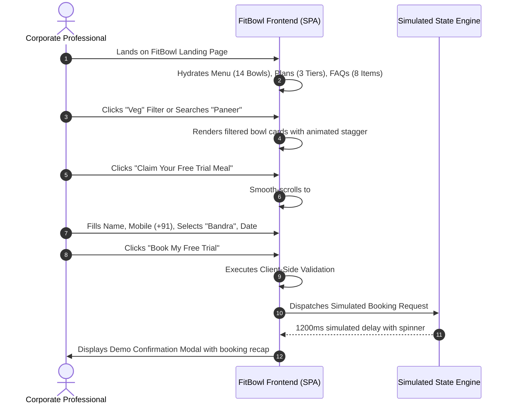

# FitBowl — Functional Requirements Document (FRD)

**Document Version:** 1.0.0  
**Document Status:** Approved for Implementation  
**Last Updated:** 2026-10-18  
**Author:** Lead Technical Architect & Product Engineer  
**Cross-References:** [brd.md](file:///e:/company/practice/fitbowl/docs/brd.md), [ui-ux-specification.md](file:///e:/company/practice/fitbowl/docs/ui-ux-specification.md), [wireframe.md](file:///e:/company/practice/fitbowl/docs/wireframe.md), [architecture.md](file:///e:/company/practice/fitbowl/docs/architecture.md), [rule.md](file:///e:/company/practice/fitbowl/docs/rule.md)

---

## Table of Contents
1. [Functional Architecture & User Journeys](#1-functional-architecture--user-journeys)
2. [Functional Requirements Traceability Matrix (FR-001 to FR-014)](#2-functional-requirements-traceability-matrix-fr-001-to-fr-014)
3. [Section-by-Section Functional Specifications](#3-section-by-section-functional-specifications)
   - [FR-001: Global Navigation & Anchor Routing](#fr-001-global-navigation--anchor-routing)
   - [FR-002: Hero Display & Primary CTA Trigger](#fr-002-hero-display--primary-cta-trigger)
   - [FR-003: Menu Catalog, Dietary Filtering & Search](#fr-003-menu-catalog-dietary-filtering--search)
   - [FR-004: Special Dietary Restrictions & Friday Item Rule](#fr-004-special-dietary-restrictions--friday-item-rule)
   - [FR-005: Subscription Tier Interactive Selector](#fr-005-subscription-tier-interactive-selector)
   - [FR-006: Social Proof & Testimonials Carousel](#fr-006-social-proof--testimonials-carousel)
   - [FR-007: FAQ Interactive Accordion](#fr-007-faq-interactive-accordion)
   - [FR-008: Free Trial Booking Form Validation & Flow](#fr-008-free-trial-booking-form-validation--flow)
   - [FR-009: Out-of-Area Waitlist Routing](#fr-009-out-of-area-waitlist-routing)
   - [FR-010: Mobile Persistent Bottom CTA](#fr-010-mobile-persistent-bottom-cta)
   - [FR-011: Newsletter / Retention Subscription](#fr-011-newsletter--retention-subscription)
   - [FR-012: Operational Schedule Guardrails (Sunday Blocker)](#fr-012-operational-schedule-guardrails-sunday-blocker)
   - [FR-013: Simulated Submission Engine](#fr-013-simulated-submission-engine)
   - [FR-014: Accessible State Notifications](#fr-014-accessible-state-notifications)
4. [User Stories with Gherkin Acceptance Criteria](#4-user-stories-with-gherkin-acceptance-criteria)
5. [Analytics Tracking & Telemetry Plan](#5-analytics-tracking--telemetry-plan)
6. [Non-Functional Requirements (NFR)](#6-non-functional-requirements-nfr)
7. [Comprehensive Test Scenarios](#7-comprehensive-test-scenarios)

---

## 1. Functional Architecture & User Journeys

The FitBowl application is an interactive single-page application (SPA) built to deliver immediate feedback, rapid client-side filtering, and frictionless trial meal registration.



---

## 2. Functional Requirements Traceability Matrix (FR-001 to FR-014)

| FR ID | Feature Description | Business Requirement | Complexity | Target Component |
|---|---|---|---|---|
| **FR-001** | Global Navigation & Anchor Routing | BR-001 | Low | `Navbar.tsx` |
| **FR-002** | Hero Display & Dual CTA System | BR-001, BR-002 | Low | `Hero.tsx` |
| **FR-003** | Menu Catalog, Dietary Filtering & Live Search | BR-008 | Medium | `MenuSection.tsx` |
| **FR-004** | Friday Item Availability Rule (Mutton Keema) | BR-009 | Low | `BowlCard.tsx` |
| **FR-005** | Subscription Pricing Plan Presentation | BR-010, BR-011 | Low | `PricingSection.tsx` |
| **FR-006** | Testimonials Carousel & Star Ratings | BR-012 | Low | `Testimonials.tsx` |
| **FR-007** | FAQ Interactive Accordion with ARIA | BR-013, BR-014 | Low | `FAQSection.tsx` |
| **FR-008** | Free Trial Booking Form & Validation | BR-002, BR-003, BR-004 | High | `TrialForm.tsx` |
| **FR-009** | Out-of-Area Waitlist Routing | BR-005 | Medium | `TrialForm.tsx` |
| **FR-010** | Mobile Persistent Bottom Bar | BR-015 | Medium | `MobileStickyCTA.tsx` |
| **FR-011** | Newsletter / WhatsApp Retention Input | BR-002 | Low | `Newsletter.tsx` |
| **FR-012** | Sunday Delivery Blocker in Date Selection | BR-006, BR-007 | Medium | `TrialForm.tsx` |
| **FR-013** | Simulated Asynchronous Submission Engine | BR-016 | Low | `TrialForm.tsx` |
| **FR-014** | Accessibility & Focus Ring Management | BR-001 | Low | Global / Components |

---

## 3. Section-by-Section Functional Specifications

### FR-001: Global Navigation & Anchor Routing
- **Description:** Sticky navigation header containing brand logo, anchor links, and free-trial action.
- **Functional Behavior:**
  1. Sticky on scroll with blur backdrop after 50px of vertical scroll.
  2. Anchor navigation links (`#menu`, `#plans`, `#how-it-works`, `#reviews`, `#faqs`) execute smooth scrolling via `element.scrollIntoView({ behavior: 'smooth' })`.
  3. Mobile drawer opens on hamburger tap, disabling background body scroll while active.
  4. Esc key or tapping outside the mobile drawer immediately dismisses it.

### FR-002: Hero Display & Primary CTA Trigger
- **Description:** Above-the-fold engagement unit driving user conversion.
- **Functional Behavior:**
  1. Primary CTA button (`Claim Your Free Trial Meal ->`) smoothly transitions viewport to `#trial-form`.
  2. Secondary CTA (`Watch How It Works`) navigates to `#how-it-works` or displays an inline explainer modal.
  3. Trust chips display responsive tooltips on desktop hover explaining zero-commitment terms.

### FR-003: Menu Catalog, Dietary Filtering & Live Search
- **Description:** Interactive display of all 14 signature bowls.
- **Functional Behavior:**
  1. State variables: `activeFilter` (`'all' | 'veg' | 'non-veg'`), `searchQuery` (`string`).
  2. Filter Buttons: Clicking `Veg` filters list to dishes with `type === 'veg'` (7 dishes). Clicking `Non-Veg` filters to `type === 'non-veg'` (7 dishes). Clicking `All` shows all 14 dishes.
  3. Live Search: Debounced (150ms) case-insensitive search matching dish name or ingredient text.
  4. If filter + search yields 0 items, display empty-state message with a "Reset Filters" action button.
  5. Clicking a dish's `+` action button passes the dish name to the Trial Booking Form and auto-scrolls down.

### FR-004: Special Dietary Restrictions & Friday Item Rule
- **Description:** Enforces business availability rules on dishes.
- **Functional Behavior:**
  1. Dish #14 (**Mutton Keema Bowl**) displays a permanent visual badge: `Fridays Only`.
  2. If the user pre-selects Mutton Keema Bowl for the free trial, the date picker defaults to or restricts selection to upcoming Fridays.
  3. Jain dietary query: An informational tooltip explains that Jain meals are currently in development and not yet available.

### FR-005: Subscription Tier Interactive Selector
- **Description:** Presentation of the 3 subscription tiers.
- **Functional Behavior:**
  1. Starter: 5 meals / ₹1,450 (₹290 per meal).
  2. Regular: 10 meals / ₹2,700 (₹270 per meal) — flagged as `Most Popular` with default elevated prominence.
  3. Pro: 20 meals / ₹5,000 (₹250 per meal).
  4. Clicking `Get Started ->` on any plan passes the plan type into the trial/checkout context and smoothly navigates to the booking section.

### FR-006: Social Proof & Testimonials Carousel
- **Description:** Verified customer feedback display.
- **Functional Behavior:**
  1. Desktop displays all 4 reviews in a static 4-column row.
  2. Mobile displays a touch-swipeable carousel with snap-scroll and pagination dots.
  3. Exactly 4 reviews: Riya S. (Marketing), Karan M. (Product Manager), Sneha P. (Consultant), Arjun K. (Software Engineer).

### FR-007: FAQ Interactive Accordion
- **Description:** Expandable accordion answering 8 operational questions.
- **Functional Behavior:**
  1. Exactly 8 questions split into 2 columns on desktop (4 each).
  2. Clicking a question header toggles its open/closed state.
  3. Allows multiple items open simultaneously or enforces single-item accordion based on user preference.
  4. Accessible via keyboard: `Enter` or `Space` activates header; `aria-expanded` and `aria-controls` update dynamically.

### FR-008: Free Trial Booking Form Validation & Flow
- **Description:** Primary conversion form capturing trial bookings.
- **Required Inputs & Validation Rules:**
  - `fullName`: Required, string, trimmed length `>= 2` characters, regex `/^[a-zA-Z\s]+$/`.
  - `mobile`: Required, 10 digits, regex `/^[6-9]\d{9}$/` (standard Indian mobile numbers starting with 6, 7, 8, or 9).
  - `deliveryArea`: Required, dropdown selection from `['andheri', 'bandra', 'powai', 'lower-parel', 'other']`.
  - `dietaryPreference`: Required, `'veg' | 'non-veg'`.
  - `deliveryDate`: Required, ISO date string, must be between tomorrow and +14 days; Sunday dates strictly disallowed.
- **Validation Trigger:** Validates on input blur and on submit attempt. Inline error text appears below invalid fields.

### FR-009: Out-of-Area Waitlist Routing
- **Description:** Handles users residing outside pilot areas.
- **Functional Behavior:**
  1. When `deliveryArea === 'other'`, the form interface dynamically adapts:
     - Delivery date picker is replaced with an optional "Your Area / Pin Code" text input.
     - Primary button label updates from `Book My Free Trial ->` to `Join Expansion Waitlist ->`.
     - An informational notice displays: *"We currently deliver only in Andheri, Bandra, Powai, and Lower Parel. Join our waitlist and we will notify you when we expand to your area!"*
  2. Submitting this flow triggers a dedicated waitlist success message without creating a meal delivery ticket.

### FR-010: Mobile Persistent Bottom CTA
- **Description:** Floating bottom conversion trigger on small viewports.
- **Functional Behavior:**
  1. Hidden when scroll position `< 400px` (user is reading the hero).
  2. Slides up smoothly with `translateY(0)` when scroll position `>= 400px`.
  3. Tapping the bar triggers smooth scroll to `#trial-form`.
  4. Automatically hides when `#trial-form` is visible in the viewport to avoid UI clutter.

### FR-011: Newsletter / Retention Subscription
- **Description:** Single-field retention capture.
- **Functional Behavior:**
  1. Validates standard mobile or email format.
  2. Triggers simulated submission toast: *"You're in! We'll notify you about new bowls and discounts."*

### FR-012: Operational Schedule Guardrails (Sunday Blocker)
- **Description:** Prevents delivery scheduling on non-operational days.
- **Functional Behavior:**
  1. Date picker component disables all Sunday dates (`day.getDay() === 0`).
  2. Minimum selectable date is `tomorrow` (same-morning batch cooking cutoff).
  3. Operating hours displayed alongside: Lunch 12–2 PM, Dinner 7–9 PM.

### FR-013: Simulated Asynchronous Submission Engine
- **Description:** Emulates realistic network transactions on the client.
- **Functional Behavior:**
  1. On valid form submission, button transitions into a disabled state displaying an animated spinner and text: `Confirming Your Free Trial...`.
  2. Introduces an intentional `1200ms` promise delay simulating network transmission.
  3. Displays a rich success dialog confirming submission with a prominent disclaimer: *"Demo Simulation: No real order was placed. In production, this dispatches a confirmation SMS to your mobile."*
  4. Resets form inputs upon dialog dismissal.

### FR-014: Accessible State Notifications
- **Description:** ARIA live region support for screen readers.
- **Functional Behavior:**
  1. Form errors announce via `role="alert"`.
  2. Submission success announces via `aria-live="polite"`.

---

## 4. User Stories with Gherkin Acceptance Criteria

### User Story 1: Free Trial Booking (Happy Path)
```gherkin
Feature: Free Trial Booking
  As a busy corporate professional in Bandra
  I want to book a single free trial lunch bowl
  So that I can test FitBowl's taste and delivery quality without financial commitment

  Scenario: Successful trial booking within supported area
    Given the user is on the FitBowl landing page
    When the user scrolls to "#trial-form"
    And enters "Karan Mehta" as full name
    And enters "9820198201" as mobile number
    And selects "Bandra" as delivery area
    And selects "Non-Vegetarian" as dietary preference
    And selects a valid upcoming Thursday delivery date
    And clicks "Book My Free Trial"
    Then the submit button shows a loading spinner for 1.2 seconds
    And a confirmation modal appears displaying the chosen details
    And the modal clearly discloses that this is a simulated demo booking
```

### User Story 2: Out-of-Area Waitlist Redirection
```gherkin
Feature: Out of Area Lead Capture
  As a visitor working in Thane (outside pilot zones)
  I want to submit my area interest
  So that FitBowl prioritizes expanding to my location

  Scenario: User selects unsupported delivery area
    Given the user is filling the trial booking form
    When the user selects "Other (Outside Mumbai Service Areas)" in the delivery area dropdown
    Then the submit button text changes to "Join Expansion Waitlist ->"
    And a helpful message explains current coverage is restricted to Andheri, Bandra, Powai, and Lower Parel
    When the user clicks "Join Expansion Waitlist"
    Then a success message confirms they have been added to the expansion priority list
```

### User Story 3: Menu Dietary Filtering
```gherkin
Feature: Menu Filtering
  As a strict vegetarian user
  I want to filter the 14 signature bowls to show only vegetarian dishes
  So that I do not see any meat or fish options

  Scenario: User clicks Veg filter chip
    Given the user is viewing the "Explore Our 14 Bowls" section
    When the user clicks the "Veg" filter chip
    Then the menu grid updates to display exactly 7 vegetarian bowls
    And none of the non-vegetarian dishes are visible
    And each displayed card shows the green Veg indicator dot
```

---

## 5. Analytics Tracking & Telemetry Plan

All interactions are instrumented with standardized telemetry events:

| Event Name | Trigger Condition | Event Parameters |
|---|---|---|
| `page_view` | Initial page mount | `page_title`, `viewport_width` |
| `cta_click` | Clicking any Free Trial button | `cta_location` (`navbar`, `hero`, `sticky_bar`, `pricing`) |
| `menu_filter_change` | Clicking dietary filter | `selected_filter` (`all`, `veg`, `non-veg`) |
| `menu_search` | User enters query in search field | `search_term`, `results_count` |
| `plan_select_click` | Clicking "Get Started" on pricing plan | `plan_name` (`starter`, `regular`, `pro`), `plan_price` |
| `faq_item_toggle` | Clicking FAQ accordion item | `faq_question`, `action` (`opened`, `closed`) |
| `trial_form_attempt` | User clicks submit on trial form | `delivery_area`, `food_pref` |
| `trial_form_validation_fail` | Form fails client-side validation | `invalid_fields` (array of field names) |
| `trial_booking_simulated` | Simulated submission succeeds | `delivery_area`, `food_pref`, `delivery_date` |
| `waitlist_submitted` | Out-of-area waitlist submitted | `mobile_number_hash`, `area_noted` |

---

## 6. Non-Functional Requirements (NFR)

1. **Performance:**
   - Lighthouse Performance Score `>= 90`.
   - Largest Contentful Paint (LCP) `< 2.2s` on mobile 4G.
   - Cumulative Layout Shift (CLS) `< 0.05`.
   - Interaction to Next Paint (INP) `< 100ms`.
2. **Accessibility:**
   - WCAG 2.1 Level AA compliance across all components.
   - Keyboard navigable forms and accordions with clear focus indicators.
   - Contrast ratio `>= 4.5:1` for regular text, `>= 3:1` for UI components.
3. **Browser Compatibility:**
   - Chrome / Chromium (latest 2 versions)
   - Apple Safari / iOS Safari (latest 2 versions)
   - Mozilla Firefox (latest 2 versions)
   - Microsoft Edge (latest 2 versions)

---

## 7. Comprehensive Test Scenarios

| Test Case ID | Test Description | Expected Result | Status |
|---|---|---|---|
| **TC-001** | Load home page on desktop (1440px) | Navbar, Hero, Benefits, Menu (14 bowls), Plans (3), Steps, Reviews (4), FAQ (8), Form, Footer render without errors | Pending Run |
| **TC-002** | Test smooth scroll from Navbar links | Viewport animates smoothly to designated section IDs without abrupt jumps | Pending Run |
| **TC-003** | Filter menu by Veg, Non-Veg, All | Exactly 7 veg bowls appear for Veg; 7 non-veg for Non-Veg; 14 for All | Pending Run |
| **TC-004** | Search for "Paneer" in menu | Only dishes with "Paneer" in title or description display | Pending Run |
| **TC-005** | Verify Mutton Keema Friday badge | Card #14 renders with "Fridays Only" badge | Pending Run |
| **TC-006** | Test pricing plan highlighting | Regular plan is visually elevated with "Most Popular" badge | Pending Run |
| **TC-007** | FAQ accordion keyboard interaction | Pressing Space/Enter toggles question answer; ARIA attributes update | Pending Run |
| **TC-008** | Trial form invalid mobile validation | Entering "12345" displays error: "Please enter a valid 10-digit mobile number" | Pending Run |
| **TC-009** | Out-of-area selection in trial form | Selecting "Other" alters button to "Join Expansion Waitlist" | Pending Run |
| **TC-010** | Sunday blocker in date picker | Sunday dates are disabled and cannot be selected | Pending Run |
| **TC-011** | Simulated form submission flow | Displays loading spinner for 1.2s, followed by demo disclosure modal | Pending Run |
| **TC-012** | Mobile sticky bottom CTA behavior | Hidden at top, appears when scroll > 400px, clicking jumps to trial form | Pending Run |
