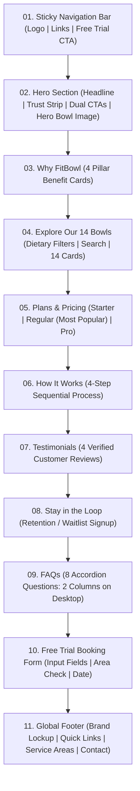

# FitBowl — Website Wireframe & Responsive Layout Specification

**Document Version:** 1.0.0  
**Status:** Approved for Implementation  
**Last Updated:** 2026-10-18  
**Author:** Senior Product Architect & UI/UX Specialist  
**Design Reference:** Approved FitBowl Wireframe (Desktop 1440px / Mobile 390px)  
**Cross-References:** [ui-ux-specification.md](file:///e:/company/practice/fitbowl/docs/ui-ux-specification.md), [brd.md](file:///e:/company/practice/fitbowl/docs/brd.md), [frd.md](file:///e:/company/practice/fitbowl/docs/frd.md), [phases.md](file:///e:/company/practice/fitbowl/docs/phases.md)

---

## Table of Contents
1. [Overview & Layout Architecture](#1-overview--layout-architecture)
2. [Global Page Layout & Mermaid Structure](#2-global-page-layout--mermaid-structure)
3. [Section 01: Navigation Bar](#3-section-01-navigation-bar)
4. [Section 02: Hero Section](#4-section-02-hero-section)
5. [Section 03: Why FitBowl (Benefits)](#5-section-03-why-fitbowl-benefits)
6. [Section 04: Explore Our 14 Bowls (Menu)](#6-section-04-explore-our-14-bowls-menu)
7. [Section 05: Subscription Plans & Pricing](#7-section-05-subscription-plans--pricing)
8. [Section 06: How It Works](#8-section-06-how-it-works)
9. [Section 07: Customer Testimonials](#9-section-07-customer-testimonials)
10. [Section 08: Newsletter / Visitor Retention](#10-section-08-newsletter--visitor-retention)
11. [Section 09: Frequently Asked Questions (FAQ)](#11-section-09-frequently-asked-questions-faq)
12. [Section 10: Free Trial Booking Form](#12-section-10-free-trial-booking-form)
13. [Section 11: Footer](#13-section-11-footer)
14. [Mobile-Specific Components: Sticky CTA Bar](#14-mobile-specific-components-sticky-cta-bar)

---

## 1. Overview & Layout Architecture

The FitBowl landing page is engineered as a single-page high-converting narrative tailored for mobile and desktop screens. It guides high-intent visitors from initial appetite appeal through nutritional reassurance, transparent pricing, operational trust, and frictionless free-trial booking.

### 1.1 Responsive Viewport Targets
- **Desktop Canvas (Primary):** `1440px` width reference with a centered `1280px` max-width content container and `32px` side padding.
- **Mobile Canvas (Primary):** `390px` width reference (representing contemporary iPhone / Android widths) with `16px` gutters.
- **Tablet (Intermediate):** `768px` to `1024px` fluid layout transitioning multi-column desktop grids into 2-column or stacked arrangements.

---

## 2. Global Page Layout & Mermaid Structure



---

## 3. Section 01: Navigation Bar

### 3.1 Purpose & Role
Establishes brand presence, provides anchor jumping across primary page landmarks, and keeps the conversion CTA (`Claim Free Trial`) permanently accessible.

### 3.2 Content Hierarchy
1. Brand Logo: `fitbowl VEG & NON-VEG` (Home reset anchor).
2. Navigation Links: `Menu`, `Plans`, `How It Works`, `Reviews`, `FAQs`.
3. Action Target: `Claim Free Trial ->` button.

### 3.3 Layout Specifications

#### Desktop (1440px)
- Fixed or sticky top bar spanning 100% width with `rgba(255, 247, 232, 0.9)` background and `backdrop-blur-md` on scroll.
- Three-zone flexbox:
  - Left: Official FitBowl logo lockup (width: 140px).
  - Center: 5 navigation anchors with 32px horizontal spacing.
  - Right: Primary CTA pill button (`Claim Free Trial ->`) in `#173F32` or `#F47738`.

#### Mobile (390px)
- Compact 56px height header.
- Left: Official logo (width: 110px).
- Right: Hamburger icon button triggering a slide-over navigation drawer containing links and a full-width trial button.

### 3.4 Wireframe Representation
```text
+---------------------------------------------------------------------------------------+
| [LOGO: fitbowl]         Menu   Plans   How It Works   Reviews   FAQs     [Claim Free Trial ->] |
+---------------------------------------------------------------------------------------+
```

### 3.5 Acceptance Criteria
- [ ] Navbar remains sticky on scroll with a subtle shadow and blur effect.
- [ ] Clicking any navigation link smoothly scrolls to the target section ID (`#menu`, `#plans`, `#how-it-works`, `#reviews`, `#faqs`).
- [ ] Clicking `Claim Free Trial ->` smoothly scrolls to or opens `#trial-form`.
- [ ] Mobile drawer opens smoothly without layout shift and closes on background tap or link click.

---

## 4. Section 02: Hero Section

### 4.1 Purpose & Role
Captures immediate user attention within 3 seconds, communicates core value proposition (healthy meals that taste exceptional), delivers key trust assurances, and drives trial bookings.

### 4.2 Content Hierarchy
1. Location Kicker: `FRESH BOWLS • MUMBAI`
2. Main Headline: `Healthy doesn't have to taste healthy.` ("taste" styled in bold orange `#F47738`)
3. Subtitle: `Delicious, freshly prepared bowls delivered to your home or office.`
4. Trust Chip Strip:
   - `One meal free` | `No card needed`
   - `Freshly prepared` | `Every day`
   - `Delivered to your` | `Home or office`
   - `No artificial stuff` | `Just real food`
5. CTAs:
   - Primary: `Claim Your Free Trial Meal ->` (Solid Orange pill)
   - Secondary: `Watch How It Works` (Play button icon + `01:30 min`)
6. Visual Element: Oversized top-down fresh meal bowl with floating badges:
   - Top right: *"Real Ingredients Real Flavours"*
   - Bottom right: *"Good Food Busy Life Sorted!"*

### 4.3 Layout Specifications

#### Desktop (1440px)
- Two-column grid (55% left copy / 45% right imagery).
- Left side: Vertical stack with tight spacing, trust pills in a 2x2 or 4-item horizontal row, and prominent CTA grouping.
- Right side: High-resolution bowl photograph with gentle CSS floating animation and pinned badge pills.

#### Mobile (390px)
- Single-column vertical stack.
- Top: Kicker, H1 headline (32px-36px), and subtitle.
- Middle: Primary full-width CTA button `Claim Your Free Trial Meal ->`.
- Below CTA: Horizontal scrollable or 2x2 grid of trust badges.
- Bottom: Hero bowl photograph (280px-320px diameter) with overlaid badges.

### 4.4 Wireframe Representation
```text
+---------------------------------------------------------------------------------------+
| FRESH BOWLS • MUMBAI                                    /~~~~~~~~~~~~~~~~~~\          |
|                                                        /                    \         |
| Healthy doesn't have to                               |   HERO FOOD BOWL     |        |
| [taste] healthy.                                      |   TOP-DOWN PHOTO     |        |
|                                                        \                    /         |
| Delicious, freshly prepared bowls delivered to          \~~~~~~~~~~~~~~~~~~/          |
| your home or office.                                     [Real Ingredients]           |
|                                                          [Good Food Busy Life Sorted] |
| [One meal free]   [Freshly prepared]                                                  |
| [Delivered home]  [No artificial stuff]                                               |
|                                                                                       |
| [Claim Your Free Trial Meal ->]   (>) Watch How It Works (01:30 min)                  |
+---------------------------------------------------------------------------------------+
```

### 4.5 Acceptance Criteria
- [ ] H1 renders with "taste" highlighted in `#F47738`.
- [ ] All four trust chips render with appropriate Lucide icons.
- [ ] Primary CTA links to `#trial-form`.
- [ ] Secondary CTA opens an explainer video modal or scrolls to `#how-it-works`.
- [ ] Hero image loads with `priority` attribute to satisfy LCP benchmarks.

---

## 5. Section 03: Why FitBowl (Benefits)

### 5.1 Purpose & Role
Addresses user skepticism and pain points by articulating the four core value pillars of FitBowl in scannable visual chunks.

### 5.2 Content Hierarchy
1. Section Title: `Why FitBowl?` (H2 Bricolage Grotesque, centered)
2. Four Benefit Cards:
   - Card 1: Icon (Leaf) | Title: `Tasty & Healthy` | Copy: `Flavour-packed bowls with balanced nutrition.`
   - Card 2: Icon (Clock) | Title: `Made for Busy You` | Copy: `Save time, eat better.`
   - Card 3: Icon (Salad) | Title: `Real Ingredients` | Copy: `No artificial stuff. Just real food.`
   - Card 4: Icon (Delivery Van) | Title: `Convenient Delivery` | Copy: `To your home or office in Mumbai.`

### 5.3 Layout Specifications

#### Desktop (1440px)
- 4-column horizontal card grid.
- Each card: White background `#FFFFFF`, rounded 20px, light border `#EADDC9`, subtle shadow, hover elevation of -4px.

#### Mobile (390px)
- 2x2 compact grid or vertical card stack with 12px gaps.
- Icon aligned left or centered above title.

### 5.4 Wireframe Representation
```text
                                     Why FitBowl?
+-------------------+ +-------------------+ +-------------------+ +-------------------+
|   (Leaf Icon)     | |   (Clock Icon)    | |   (Salad Icon)    | |    (Van Icon)     |
| Tasty & Healthy   | | Made for Busy You | | Real Ingredients  | | Convenient Deliv. |
| Flavour-packed... | | Save time, eat... | | No artificial...  | | To your home or...|
+-------------------+ +-------------------+ +-------------------+ +-------------------+
```

### 5.5 Acceptance Criteria
- [ ] All 4 benefits display exact assigned copy.
- [ ] Cards have consistent height and responsive wrapping.
- [ ] Hover states trigger smooth elevation transitions.

---

## 6. Section 04: Explore Our 14 Bowls (Menu)

### 6.1 Purpose & Role
Showcases culinary variety, ingredient quality, and macro transparency. Enables users to explore, filter, and search all 14 signature bowls.

### 6.2 Content Hierarchy
1. Kicker: `OUR MENU`
2. Headline: `Explore Our 14 Bowls`
3. Subtitle: `From Indian classics to global flavours, there's a bowl for every mood.`
4. Controls Bar:
   - Dietary Segmented Filters: `All` | `Veg` | `Non-Veg`
   - Search Field: `Search bowls...` with magnifying glass icon
5. Bowl Grid: 14 cards displaying image, dietary badge, title, macros, ingredient description, and add/select action.
6. Bottom CTA: `View All 14 Bowls ->`

### 6.3 Complete Menu Specifications (14 Bowls)

| # | Bowl Name | Type | Calories | Protein | Ingredients & Key Copy | Availability |
|---|---|---|---:|---:|---|---|
| 1 | **Peri Peri Paneer Bowl** | Veg | 520 kcal | 28 g | Grilled paneer, brown rice, peri peri sauce, charred corn. | Daily (Mon–Sat) |
| 2 | **Butter Chicken Lite** | Non-veg | 560 kcal | 38 g | Lighter butter chicken, jeera rice, cucumber raita. | Daily (Mon–Sat) |
| 3 | **Rajma Chawal Remix** | Veg | 480 kcal | 18 g | Slow-cooked rajma, red rice, pickled onions. | Daily (Mon–Sat) |
| 4 | **Thai Basil Chicken** | Non-veg | 510 kcal | 36 g | Minced chicken, thai basil, jasmine brown rice, stir-fried beans. | Daily (Mon–Sat) |
| 5 | **Mexican Burrito Bowl** | Veg | 540 kcal | 22 g | Black beans, fajita peppers, salsa fresca, quinoa, guacamole. | Daily (Mon–Sat) |
| 6 | **Tandoori Fish Bowl** | Non-veg | 450 kcal | 34 g | Spiced grilled fish, mint chutney, millet pilaf, kachumber. | Daily (Mon–Sat) |
| 7 | **Chole Quinoa Bowl** | Veg | 470 kcal | 19 g | Amritsari chole, spiced quinoa, roasted seeds, pickled beetroot. | Daily (Mon–Sat) |
| 8 | **Korean Chicken Bowl** | Non-veg | 590 kcal | 35 g | Gochujang glazed chicken, sticky brown rice, kimchi, sesame greens. | Daily (Mon–Sat) |
| 9 | **Palak Tofu Bowl** | Veg | 430 kcal | 24 g | Sautéed tofu, creamy spinach puree, garlic brown rice. | Daily (Mon–Sat) |
| 10 | **Egg Bhurji Power Bowl** | Non-veg | 490 kcal | 30 g | Spiced scrambled eggs, sauteed spinach, sweet potato mash. | Daily (Mon–Sat) |
| 11 | **Mediterranean Falafel** | Veg | 550 kcal | 20 g | Baked falafel, creamy hummus, grilled veggies, quinoa, olive dressing. | Daily (Mon–Sat) |
| 12 | **Chicken Biryani Fit** | Non-veg | 600 kcal | 37 g | Layered fragrant brown basmati, lean marinated chicken, raita. | Daily (Mon–Sat) |
| 13 | **Teriyaki Mushroom Bowl** | Veg | 460 kcal | 16 g | Glazed portobello mushrooms, edamame, soba noodles, sesame seeds. | Daily (Mon–Sat) |
| 14 | **Mutton Keema Bowl** | Non-veg | 620 kcal | 40 g | Slow-simmered lean mutton keema, whole wheat pav/rice, fresh mint. | **Fridays Only** |

### 6.4 Layout Specifications

#### Desktop (1440px)
- Controls bar with filters on left and search on right.
- 4-column card grid (4 cards per row, 4 rows total = 14 bowls + potential action tile).
- Each card contains:
  - Dish photograph with zoom on hover.
  - Dietary Pill (`Veg` green / `Non-Veg` orange) overlaid at top-left.
  - Friday-Only badge on Mutton Keema Bowl.
  - H3 Bowl Title.
  - Nutrition indicator: `[520 kcal | 28g protein]`.
  - 2-line ingredient description.
  - `+` circle button linking to trial selection.

#### Mobile (390px)
- Filter pills wrap horizontally with touchable hit targets.
- Search input sits below filters.
- Horizontal swipeable card row with indicator dots, or single-column stackable cards.

### 6.5 Wireframe Representation
```text
OUR MENU
Explore Our 14 Bowls
From Indian classics to global flavours, there's a bowl for every mood.

[ (All)  Veg  Non-Veg ]                              [ Search bowls... (Q) ]

+----------------------+ +----------------------+ +----------------------+
| [IMG]                | | [IMG]                | | [IMG]                |
| (Veg)                | | (Non-Veg)            | | (Veg)                |
| Peri Peri Paneer     | | Butter Chicken Lite  | | Rajma Chawal Remix   |
| 520 kcal | 28g prot. | | 560 kcal | 38g prot. | | 480 kcal | 18g prot. |
| Grilled paneer,      | | Lighter butter chk,  | | Slow-cooked rajma,   |
| brown rice...    (+) | | jeera rice...    (+) | | red rice...      (+) |
+----------------------+ +----------------------+ +----------------------+
```

### 6.6 Acceptance Criteria
- [ ] All 14 bowls render with exact names, calories, protein, and descriptions.
- [ ] Filtering by `Veg` displays exactly 7 vegetarian bowls; `Non-Veg` displays exactly 7 non-vegetarian bowls.
- [ ] Mutton Keema Bowl prominently displays its `Fridays Only` availability badge.
- [ ] Live search filters bowls instantly by name or ingredients.
- [ ] Selecting a bowl's `+` button pre-selects the dish in the trial form.

---

## 7. Section 05: Subscription Plans & Pricing

### 7.1 Purpose & Role
Provides clear, transparent pricing with no hidden charges, highlighting flexible subscription tiers and emphasizing the popular 10-meal plan.

### 7.2 Content Hierarchy
1. Feature Container: Dark Forest Green `#173F32` bounding box with warm cream interior typography.
2. Left Header Area:
   - Title: `Choose a Plan`
   - Subtitle: `Fresh meals, flexible plans. Most people go for the 10-meal plan.`
   - Editorial Badge: *"Good food Great value!"*
3. Three Pricing Plan Cards:
   - **Starter:** 5 meals/month | `₹1,450` (`₹290 per meal`) | Features | `Get Started ->`
   - **Regular (Most Popular):** 10 meals/month | `₹2,700` (`₹270 per meal`) | Features | `Get Started ->`
   - **Pro:** 20 meals/month | `₹5,000` (`₹250 per meal`) | Features | `Get Started ->`
4. Standard Features Included in All Plans:
   - Free delivery across Mumbai hubs
   - Pause or cancel anytime
   - Choose meals every week
5. Floating Editorial Callout: *"Same great taste. Different bowls every week."*

### 7.3 Layout Specifications

#### Desktop (1440px)
- Unified container with dark forest green background.
- Left 30% area holds the section header and editorial flair.
- Right 70% area houses the 3 plan cards in a horizontal flex grid.
- Regular card is visually elevated with an orange border, top `Most Popular` badge, and solid orange CTA button.

#### Mobile (390px)
- Container spans full viewport width with rounded top corners.
- Horizontal carousel with `<` and `>` pagination controls.
- Default view centers the `Regular` plan card.

### 7.4 Wireframe Representation
```text
+-------------------------------------------------------------------------------------------------+
| Choose a Plan              +---------------+  +---------------------+  +---------------+        |
| Fresh meals, flexible      | Starter       |  | [Most Popular]      |  | Pro           |        |
| plans. Most people go      | 5 meals/month |  | Regular             |  | 20 meals/month|        |
| for the 10-meal plan.      | ₹1,450        |  | 10 meals/month      |  | ₹5,000        |        |
|                            | ₹290/meal     |  | ₹2,700              |  | ₹250/meal     |        |
| (Good food                 |               |  | ₹270/meal           |  |               |        |
|  Great value!)             | v Free deliv. |  | v Free deliv.       |  | v Free deliv. |        |
|                            | v Pause/cancel|  | v Pause/cancel      |  | v Pause/cancel|        |
|                            | v Choose meals|  | v Choose meals      |  | v Choose meals|        |
|                            |               |  |                     |  |               |        |
|                            | [Get Started] |  | [Get Started ->]    |  | [Get Started] |        |
|                            +---------------+  +---------------------+  +---------------+        |
+-------------------------------------------------------------------------------------------------+
```

### 7.5 Acceptance Criteria
- [ ] Prices match exact requirements: Starter (₹1,450 / ₹290), Regular (₹2,700 / ₹270), Pro (₹5,000 / ₹250).
- [ ] Regular plan displays the prominent `Most Popular` badge.
- [ ] Inclusions (Free delivery, Pause/cancel anytime, Choose meals weekly) appear on every card.
- [ ] Clicking `Get Started ->` scrolls to the trial form with the chosen plan pre-selected.

---

## 8. Section 06: How It Works

### 8.1 Purpose & Role
Demystifies the free trial process and ongoing subscription flow in 4 logical, confidence-building steps.

### 8.2 Content Hierarchy
1. Kicker: `IT'S SIMPLE`
2. Headline: `How It Works`
3. Subtitle: `Your free trial meal in 4 simple steps.`
4. 4 Step Blocks:
   - **Step 1:** Number badge `1` | Icon (Bowl) | Title: `Choose Your Bowl` | Copy: `Pick from 14 delicious options.`
   - **Step 2:** Number badge `2` | Icon (Clipboard/Form) | Title: `Book Your Free Trial` | Copy: `Fill in a quick form.`
   - **Step 3:** Number badge `3` | Icon (Delivery Truck) | Title: `We Deliver` | Copy: `Fresh to your home or office.`
   - **Step 4:** Number badge `4` | Icon (Enjoy/Smile) | Title: `Enjoy` | Copy: `Tasty, healthy and hassle-free.`

### 8.3 Layout Specifications

#### Desktop (1440px)
- 4-column horizontal layout connected with a subtle green dashed line and directional chevrons.
- Circular step badges with alternating green/orange accent fills.

#### Mobile (390px)
- Vertical timeline or 4-row stack with vertical connector line on left.

### 8.4 Wireframe Representation
```text
                                    IT'S SIMPLE
                                   How It Works
                       Your free trial meal in 4 simple steps.

   ( 1 )                 ( 2 )                 ( 3 )                 ( 4 )
 Choose Your Bowl  -->  Book Your Trial  -->    We Deliver     -->       Enjoy
Pick from 14 opt.      Fill in quick form.    Fresh to home/off.     Tasty & healthy.
```

### 8.5 Acceptance Criteria
- [ ] Numbered steps 1 through 4 display exact assigned copy.
- [ ] Step icons and numbering render clearly across mobile and desktop.

---

## 9. Section 07: Customer Testimonials

### 9.1 Purpose & Role
Establishes authentic social proof from relatable Mumbai corporate professionals with specific role designations.

### 9.2 Content Hierarchy
1. Kicker: `TESTIMONIALS`
2. Headline: `What Our Customers Say`
3. Subtitle: `Real people. Real results.`
4. 4 Exact Verified Reviews:
   - **Review 1:** Rating: 5 Stars | Quote: *"The food is amazing and super convenient. Perfect for my busy schedule."* | Author: **Riya S.** | Role: `Marketing Professional`
   - **Review 2:** Rating: 5 Stars | Quote: *"Great taste and portions. Finally a healthy option that feels like a treat."* | Author: **Karan M.** | Role: `Product Manager`
   - **Review 3:** Rating: 5 Stars | Quote: *"Love the variety! My go-to for healthy meals in the office."* | Author: **Sneha P.** | Role: `Consultant`
   - **Review 4:** Rating: 5 Stars | Quote: *"Delicious, fresh and always on time. Highly recommend!"* | Author: **Arjun K.** | Role: `Software Engineer`

### 9.3 Layout Specifications

#### Desktop (1440px)
- 4 equal cards in a horizontal row.
- Each card: White background, 5 golden stars, quote text, customer avatar thumbnail, name, and designation.

#### Mobile (390px)
- Horizontal swipeable carousel with indicator dots.

### 9.4 Acceptance Criteria
- [ ] All 4 reviews match exact names, roles, and quote text.
- [ ] Star ratings render as 5 filled stars.
- [ ] No fabricated or unverified claims added.

---

## 10. Section 08: Newsletter / Visitor Retention

### 10.1 Purpose & Role
Captures leads who are not yet ready to order or who reside outside current delivery zones.

### 10.2 Content Hierarchy
1. Container: Dark green box `#173F32`.
2. Title: `Stay in the Loop`
3. Copy: `Be the first to know about new bowls, special offers and when we expand to your area.`
4. Form Controls:
   - Input: Mobile number or email address.
   - Button: `Notify Me ->` (Solid Orange `#F47738`).

### 10.3 Acceptance Criteria
- [ ] Input validates format before submission.
- [ ] Displays confirmation toast on simulated submission: *"Thanks! You're on the list."*

---

## 11. Section 09: Frequently Asked Questions (FAQ)

### 11.1 Purpose & Role
Eliminates purchase friction and resolves operational questions regarding delivery timings, subscription flexibility, dietary restrictions, and coverage.

### 11.2 Content Hierarchy
1. Headline: `Frequently Asked Questions` (H2 Bricolage Grotesque)
2. 8 Accordion Items (exact questions and answers):
   1. *What areas do you deliver to?*  
      Currently delivering to Andheri, Bandra, Powai, and Lower Parel in Mumbai.
   2. *What are the delivery timings?*  
      Lunch is delivered between 12:00 PM – 2:00 PM; dinner is delivered between 7:00 PM – 9:00 PM (Monday through Saturday; no Sunday delivery).
   3. *How does the free trial work?*  
      You receive 1 free trial meal with zero payment and no credit card required.
   4. *Can I pause or cancel anytime?*  
      Yes, subscriptions can be paused, modified, or canceled anytime via your account settings.
   5. *Can I choose my meals?*  
      Yes, the menu changes every Monday and you can mix veg and non-veg meals freely.
   6. *Do you use preservatives?*  
      No preservatives, artificial additives, refined sugar, or maida are ever used. Meals are cooked fresh the same morning.
   7. *Is the food really healthy?*  
      Yes, every bowl is macro-balanced with certified calorie and protein counts, cooked in cold-pressed oils.
   8. *What if I'm outside the delivery area?*  
      You can enter your details in our waitlist form; we expand into new neighborhoods based on demand.

### 11.3 Layout Specifications
- **Desktop (1440px):** 2 balanced columns (Questions 1–4 left; Questions 5–8 right).
- **Mobile (390px):** Single vertical accordion stack.

### 11.4 Acceptance Criteria
- [ ] All 8 questions and answers match assignment specifications.
- [ ] Accordion items expand/collapse smoothly with keyboard and screen reader accessibility (`aria-expanded`).

---

## 12. Section 10: Free Trial Booking Form

### 12.1 Purpose & Role
Primary conversion touchpoint. Allows qualified visitors to book a single free trial meal with zero friction and zero payment requirements.

### 12.2 Content Hierarchy
1. Headline: `Claim Your Free Trial Meal`
2. Subtitle: `No credit card required. 100% free lunch or dinner bowl delivered to your door.`
3. Form Fields:
   - **Full Name:** Text input (`min 2 characters`).
   - **Mobile Number:** 10-digit number with locked `+91` prefix.
   - **Delivery Area:** Dropdown with options:
     - `Andheri`
     - `Bandra`
     - `Powai`
     - `Lower Parel`
     - `Other (Outside Mumbai Service Areas)`
   - **Food Preference:** Segmented toggle: `Vegetarian` vs. `Non-Vegetarian`.
   - **Preferred Date:** Date picker (Monday through Saturday selectable; Sundays disabled).
4. Out-of-Area Logic:
   - If user selects `Other`, form updates CTA to `Join Expansion Waitlist ->` and provides friendly notice: *"We don't deliver to your area yet, but joining our waitlist helps us prioritize your neighborhood!"*
5. Submission Action:
   - Primary Button: `Book My Free Trial ->`
   - Disclaimer: `One free trial per customer. Monday–Saturday deliveries only.`
6. Feedback Modal:
   - Simulated 1.2-second loading spinner.
   - Confirmation dialog clearly stating: *"Demo Booking Confirmed (Simulated). No actual delivery will take place."*

### 12.3 Acceptance Criteria
- [ ] Name, mobile number, area, food preference, and date are validated before submission.
- [ ] Selecting "Other" triggers the waitlist path without attempting a trial delivery booking.
- [ ] Submission simulates a network delay without generating a real backend order.
- [ ] Accessible error messages appear directly below invalid fields.

---

## 13. Section 11: Footer

### 13.1 Purpose & Role
Provides legal assurances, verified contact details, service area confirmation, and social links.

### 13.2 Content Hierarchy
- **Brand Column:** Logo lockup `fitbowl VEG & NON-VEG HEALTHY MEALS DELIVERED`.
- **Quick Links:** `Menu`, `Plans`, `How It Works`, `Reviews`, `FAQs`.
- **Service Areas:** `Andheri`, `Bandra`, `Powai`, `Lower Parel`.
- **Contact:** `hello@fitbowl.com`, `+91 98765 43210`, `Mon - Sat, 8AM - 8PM`.
- **Social Icons:** Instagram, Facebook, YouTube, LinkedIn.
- **Editorial Graphic:** *"Good Food Busy Life Sorted!"*
- **Copyright:** `© 2026 FitBowl. All rights reserved.`

### 13.3 Acceptance Criteria
- [ ] All contact details and service areas match confirmed business details.
- [ ] Links navigate to valid internal page anchors.

---

## 14. Mobile-Specific Components: Sticky CTA Bar

### 14.1 Purpose & Behavior
On mobile screens (`< 768px`), after the user scrolls past the hero section (scroll offset > 400px), a sticky bottom conversion bar slides up.

### 14.2 Structure
- Container: Full-width bar with frosted background (`#FFF7E8` with `backdrop-blur-md`), top border `#EADDC9`.
- Button: Full-width orange pill button: `Book My Free Trial ->`.
- Click Action: Smoothly scrolls viewport directly to `#trial-form` and focuses the name input.
- Acceptance Criteria: Does not overlap with footer; respects mobile safe area insets (`env(safe-area-inset-bottom)`).
